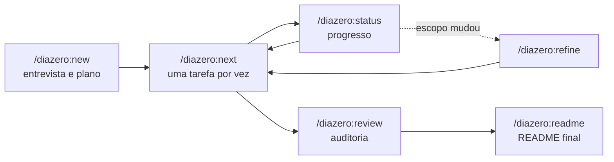

# diazero

**Do dia zero ao projeto pronto, com o Claude Code.** Planeje com uma entrevista, depois construa tarefa por tarefa, acompanhe o progresso e audite o resultado.
*From day zero to a finished project with Claude Code. Plan through an interview, then build task by task, track progress and audit the result.*

[Português](#português) · [English](#english)



---

## Português

### O problema

Quem pede "faz um app de X" para uma IA recebe código sem plano: escopo que cresce, decisões que se perdem e um projeto que ninguém sabe se está pronto. O diazero dá ao projeto um plano escrito, que a IA e você seguem juntos.

### Comandos

| Comando | O que faz |
|---|---|
| `/diazero:new [ideia]` | Entrevista (rápida ou completa), lê o repositório se já existir código e gera `PROJECT.md`, `ARCHITECTURE.md`, `TASKS.md` e `CLAUDE.md` |
| `/diazero:stack [o que construir]` | Parte de um catálogo com 28 tipos de projeto (site, loja, SaaS, API, mobile, CLI, bot, dados, IA e mais), compara 2 ou 3 stacks reais, recomenda uma e registra a decisão |
| `/diazero:next [T2.1]` | Executa a próxima tarefa do plano, roda os testes, confere o "pronto quando" e marca como feita |
| `/diazero:status` | Progresso real por fase, próximas tarefas, bloqueios e divergências entre código e plano. Só leitura |
| `/diazero:review` | Auditoria do código contra o plano: escopo extra, funcionalidades faltando, tarefas "feitas" sem evidência. Só leitura |
| `/diazero:refine [mudança]` | Mostra o impacto de uma mudança de escopo e atualiza os quatro arquivos com coerência |
| `/diazero:readme [pt-BR\|en]` | Gera o README do seu projeto a partir do plano e do código |

Também há o subagente `diazero:scope-guardian`, um auditor somente leitura usado pelo `review` e disponível para uso direto.

### O que o plano contém

- **Prioridades (MoSCoW):** o que é obrigatório na versão 1 e o que fica de fora, com motivo.
- **Esqueleto funcional primeiro:** a fase 1 termina com o menor fluxo de ponta a ponta rodando.
- **Pré-mortem:** de 3 a 5 formas prováveis de o projeto falhar, cada uma com mitigação.
- **Premissas explícitas:** tudo que foi deduzido aparece para você corrigir.
- **Tarefas verificáveis:** cada uma com ID, tamanho, dependências e "pronto quando".
- **Playbooks por tipo:** web, API, mobile, automação, biblioteca/CLI, site e projetos de dados/IA têm perguntas, riscos e tarefas iniciais próprios.

Veja um exemplo completo em [`examples/agendafacil/`](examples/agendafacil/) e um resumo em [`skills/new/example.md`](skills/new/example.md).

### Como é na prática

```text
> /diazero:new app para agendar horários em barbearias

Claude: Rápida (5 perguntas) ou completa (8)?
> Rápida

Claude: Quem usa e qual problema resolve?
        Que tipo de projeto é: web, API, mobile, automação, biblioteca...?
> Donos de barbearia pequena e os clientes deles. Web.

Claude: O que é obrigatório na versão 1 e o que fica de fora?
> Página pública de agendamento e agenda do dono. Sem pagamento.

Claude: Resumo: AgendaFácil · web · Laravel + Livewire · 5 Musts · 3 Won'ts
        Principais riscos: donos não largam o WhatsApp, LGPD, marcação dupla
        Premissas: 1 barbearia por conta, sem conta para o cliente
        Posso gerar os arquivos?
> Pode

Claude: Criei PROJECT.md, ARCHITECTURE.md, TASKS.md e CLAUDE.md.
        Maior risco: marcação dupla. Próximo passo: /diazero:next (T1.1)
```

O resultado completo desse exemplo está em [`examples/agendafacil/`](examples/agendafacil/).

### Por que não só pedir ao Claude?

| Sem plano | Com diazero |
|---|---|
| O escopo cresce a cada pedido | Won't explícito e `/diazero:refine` para mudar com critério |
| "Está pronto?" ninguém sabe | Cada tarefa tem "pronto quando" verificável |
| Decisões se perdem entre sessões | `CLAUDE.md` e `ARCHITECTURE.md` guardam o contexto |
| Código diverge da ideia original | `/diazero:review` compara código e plano com evidência |

### Instalação

Pelo marketplace, no terminal:

```bash
claude plugin marketplace add lenivalestevao/diazero
claude plugin install diazero@diazero
```

Para testar localmente a partir de um clone:

```bash
git clone https://github.com/lenivalestevao/diazero.git
claude --plugin-dir ./diazero
```

Depois, em uma pasta de projeto, dentro do Claude Code:

```
/diazero:new
```

### Perguntas frequentes

**Funciona com projetos que já existem?** Sim. O `new` lê o repositório, deduz stack e comandos e pergunta só o que falta.

**Ele sobrescreve meus arquivos?** Nunca sem perguntar. Nada é escrito antes de você confirmar o resumo.

**Os tamanhos das tarefas são prazos?** Não. S, M e L são estimativas relativas e o plano diz isso.

**Os números e versões vêm de onde?** O plugin não afirma versões, preços ou regras legais de memória. Ele verifica com busca na web quando disponível e marca "verify" quando não.

### Status

Versão 0.3, em evolução. Veja o [CHANGELOG](CHANGELOG.md). Feedback e PRs são bem-vindos (veja [CONTRIBUTING](CONTRIBUTING.md)), em especial novos playbooks por tipo de projeto e perguntas melhores.

---

## English

### The problem

Asking an AI to "build an app for X" produces code without a plan: scope that grows, decisions that get lost, and a project nobody can call finished. diazero gives the project a written plan that you and the AI follow together.

### Commands

| Command | What it does |
|---|---|
| `/diazero:new [idea]` | Interview (quick or full), reads the repo if code exists, and writes `PROJECT.md`, `ARCHITECTURE.md`, `TASKS.md` and `CLAUDE.md` |
| `/diazero:stack [what to build]` | Starts from a catalog of 28 project types (site, store, SaaS, API, mobile, CLI, bot, data, AI and more), compares 2 or 3 realistic stacks, recommends one and records the decision |
| `/diazero:next [T2.1]` | Builds the next task in the plan, runs the checks, verifies its "done when" and marks it done |
| `/diazero:status` | Real progress per phase, next tasks, blockers, and drift between code and plan. Read-only |
| `/diazero:review` | Audits the code against the plan: scope creep, missing features, tasks marked done without evidence. Read-only |
| `/diazero:refine [change]` | Shows the impact of a scope change and updates all four files consistently |
| `/diazero:readme [pt-BR\|en]` | Generates your project's README from the plan and the code |

It also ships the `diazero:scope-guardian` subagent, a read-only auditor used by `review` and available directly.

### What the plan contains

- **MoSCoW priorities:** what is a must for version 1 and what stays out, with reasons.
- **Walking skeleton first:** phase 1 ends with the thinnest end-to-end flow running.
- **Pre-mortem:** 3 to 5 likely ways the project fails, each with a mitigation.
- **Explicit assumptions:** everything inferred is shown for you to correct.
- **Verifiable tasks:** each has an ID, a size, dependencies and a "done when".
- **Playbooks by type:** web, API, mobile, automation, library/CLI, site and data/AI each bring their own questions, risks and starter tasks.

See a full example in [`examples/agendafacil/`](examples/agendafacil/) and a short one in [`skills/new/example.md`](skills/new/example.md).

### What it looks like

```text
> /diazero:new app to book appointments for barbershops

Claude: Quick (5 questions) or full (8)?
> Quick

Claude: Who uses it and what problem does it solve?
        What type of project: web, API, mobile, automation, library...?
> Small barbershop owners and their clients. Web.

Claude: What is a must for version 1 and what stays out?
> Public booking page and the owner's agenda. No payments.

Claude: Summary: AgendaFácil · web · Laravel + Livewire · 5 Musts · 3 Won'ts
        Top risks: owners keep using WhatsApp, privacy law, double booking
        Assumptions: 1 shop per account, no account for the customer
        Shall I generate the files?
> Go

Claude: Created PROJECT.md, ARCHITECTURE.md, TASKS.md and CLAUDE.md.
        Top risk: double booking. Next step: /diazero:next (T1.1)
```

The full output of this example is in [`examples/agendafacil/`](examples/agendafacil/) (in Portuguese).

### Why not just ask Claude?

| Without a plan | With diazero |
|---|---|
| Scope grows with every request | Explicit Won't list and `/diazero:refine` for deliberate changes |
| Nobody knows if it is done | Every task has a checkable "done when" |
| Decisions get lost between sessions | `CLAUDE.md` and `ARCHITECTURE.md` keep the context |
| Code drifts from the original idea | `/diazero:review` compares code and plan with evidence |

### Install

From the marketplace, in your terminal:

```bash
claude plugin marketplace add lenivalestevao/diazero
claude plugin install diazero@diazero
```

To try it locally from a clone:

```bash
git clone https://github.com/lenivalestevao/diazero.git
claude --plugin-dir ./diazero
```

Then, in a project folder, inside Claude Code:

```
/diazero:new
```

### FAQ

**Does it work on existing projects?** Yes. `new` reads the repo, infers the stack and commands, and asks only for what is missing.

**Will it overwrite my files?** Never without asking. Nothing is written until you confirm the summary.

**Are task sizes deadlines?** No. S, M and L are relative guesses and the plan says so.

**Where do numbers and versions come from?** The plugin does not state versions, prices or legal rules from memory. It checks with web search when available and writes "verify" when not.

### Status

Version 0.3, still evolving. See the [CHANGELOG](CHANGELOG.md). Feedback and PRs are welcome (see [CONTRIBUTING](CONTRIBUTING.md)), especially new playbooks by project type and better questions.

---

## Estrutura / Structure

```
diazero/
├── .claude-plugin/
│   ├── plugin.json
│   └── marketplace.json
├── agents/
│   └── scope-guardian.md
├── examples/
│   └── agendafacil/   PROJECT.md, ARCHITECTURE.md, TASKS.md, CLAUDE.md
└── skills/
    ├── new/        SKILL.md, templates.md, playbooks.md, example.md
    ├── refine/     SKILL.md
    ├── stack/      SKILL.md
    ├── next/       SKILL.md
    ├── status/     SKILL.md
    ├── review/     SKILL.md
    └── readme/     SKILL.md
```

## Licença / License

MIT
