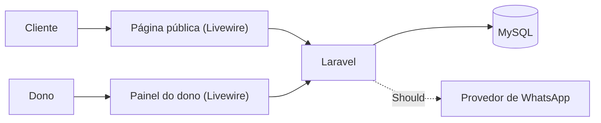

# Architecture

## Overview
Monolito Laravel com Livewire. A página pública e o painel do dono vivem na mesma aplicação. Os agendamentos ficam em MySQL, e a regra de "um profissional, um horário" é garantida pelo banco.



## Stack
| Layer | Choice | Why |
|---|---|---|
| Backend and UI | Laravel + Livewire | O desenvolvedor já domina; entrega rápida sem SPA |
| Database | MySQL | Já disponível na hospedagem escolhida |
| Hosting | VPS pequena (verify plano) | Cabe no orçamento e permite fila e agendador |
| CI | GitHub Actions | Testes a cada push |

## Folder structure
```
app/
  Models/            Barbershop, Professional, Service, Appointment
  Livewire/Public/   BookingPage
  Livewire/Admin/    DayAgenda, Services, Professionals
  Services/          SlotCalculator
database/migrations/
tests/Feature/
tests/Unit/
```

## Data model
- **Barbershop:** id, name, slug (único), phone, owner_id
- **Professional:** id, barbershop_id, name, working_hours (json)
- **Service:** id, barbershop_id, name, duration_minutes, price_cents
- **Appointment:** id, professional_id, service_id, customer_name, customer_phone, starts_at, ends_at, status (booked, cancelled, done). Único em (professional_id, starts_at).

## Interfaces
- `GET /{slug}` — página pública de agendamento
- `POST /{slug}/book` — cria o agendamento
- `GET /admin` — agenda do dia (autenticado)
- `GET /admin/services`, `GET /admin/professionals` — cadastros

## Main flows
1. **Cliente agenda:** abre `/{slug}`, escolhe serviço e profissional, vê horários livres, informa nome e telefone, confirma e vê a tela de sucesso.
2. **Dono consulta:** entra em `/admin` e vê os agendamentos do dia em ordem, com telefone para contato.

## Security and privacy
- Senhas com hash do framework; sessão com cookie seguro.
- Coleta mínima: nome e telefone, com texto de consentimento na página.
- Exclusão de dados de um cliente sob pedido, por comando do painel (LGPD).
- Segredos só em variáveis de ambiente.

## External services
- Provedor de WhatsApp (Should), ainda não escolhido. Credenciais em variáveis de ambiente.

## Environments and deploy
Local, staging e produção. Deploy por push na branch `main` após CI verde; migrações rodam no deploy.

## Testing strategy
- Unit: `SlotCalculator` (duração, intervalos, horário de atendimento).
- Feature: fluxo de agendamento e tentativa de marcação dupla.
- Sem testes de interface automatizados na versão 1.

## Decisions
| ID | Decision | Why | Rejected alternatives | Revisit when |
|---|---|---|---|---|
| D1 | Monolito Laravel | Time de uma pessoa | API separada + SPA | Mais de 3 desenvolvedores |
| D2 | Sem conta para o cliente | Reduz atrito e dados coletados | Login do cliente | Houver histórico ou fidelidade |
| D3 | Restrição única no banco contra marcação dupla | Segura mesmo sob concorrência | Checagem só na aplicação | Mudar o modelo de agenda |
