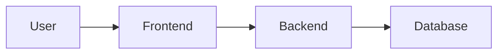

# Templates

Fill every section with specifics from the interview. Keep the headings. Write in the language chosen by the user.

## PROJECT.md

```markdown
# <Project name>

> <One-sentence description>

**Status:** planning · **Target:** version 1 · **Language:** <pt-BR | en>

## Problem
<What problem exists, for whom, and how they cope today>

## Users
<Who uses it and what each kind of user wants to accomplish>

## Scope (MoSCoW)
**Must (version 1)**
- <Feature> — <why it is essential>

**Should**
- <Feature>

**Could**
- <Feature>

**Won't (for now)**
- <Feature> — <why not yet>

## Constraints
<Deadline, budget, hosting, integrations, compliance, anything fixed>

## Success criteria
<How we know version 1 works. Measurable when possible.>

## Risks (pre-mortem)
| Risk | Likelihood | Impact | Mitigation |
|---|---|---|---|
| <Risk> | low/med/high | low/med/high | <Action> |

## Assumptions
- <Anything inferred that the user should confirm>

## Open questions
- <Anything still undecided>

## Change log
- <YYYY-MM-DD>: created
```

## ARCHITECTURE.md

````markdown
# Architecture

## Overview
<One paragraph on how the system works>



## Stack
| Layer | Choice | Why |
|---|---|---|
| <Frontend/Backend/DB/Hosting> | <Tech> | <Reason> |

## Folder structure
<A tree of the planned layout>

## Data model
<Main entities, key fields, relationships. One table or list per entity.>

## Interfaces
<API endpoints (method, path, purpose), or screens, or commands, depending on the type>

## Main flows
1. <Flow name>: <step by step, 3 to 6 steps>

## Security and privacy
<Authentication, authorization, secrets handling, personal data, applicable rules such as LGPD or GDPR>

## External services
<APIs and integrations, and how credentials are handled>

## Environments and deploy
<Local, staging, production. How a release happens.>

## Testing strategy
<What is tested at which level, and what is not>

## Decisions
| ID | Decision | Why | Rejected alternatives | Revisit when |
|---|---|---|---|---|
| D1 | <Decision> | <Reason> | <Options> | <Trigger> |
````

## TASKS.md

Order tasks so that each one leaves the project in a working state. Split anything larger than L. Sizes: S up to half a day, M about a day, L two to three days. Sizes are relative guesses, not promises.

```markdown
# Tasks

## Phase 1: Walking skeleton
- [ ] **T1.1 <Title>** (S) · depends: none
  What: <what to do>
  Done when: <result a person can check>

## Phase 2: Must features
- [ ] **T2.1 <Title>** (M) · depends: T1.1
  Feature: <Must feature it serves>
  What: ...
  Done when: ...

## Phase 3: Should features and hardening
- [ ] ...

## Phase 4: Release
- [ ] ...

## Backlog (Could and Won't)
- <Item>
```

Adjust the detail to the experience level: beginners get short explanations and smaller tasks, experienced developers get terse tasks.

## CLAUDE.md

Short and actionable. An AI assistant reads it at the start of every session.

```markdown
# <Project name>

## What this is
<Two lines from PROJECT.md>

## Stack
<Condensed list>

## Commands
<Install, run, test, lint, build. Write TBD if not defined yet.>

## Structure
<The 5 to 8 most important folders and what lives in them>

## Conventions
- <Naming, structure and style rules that follow the stack>
- Follow ARCHITECTURE.md. Ask before changing the stack or the data model.

## How to work here
1. Read TASKS.md and take the first unchecked task whose dependencies are done.
2. One task at a time, with small diffs.
3. Run tests and lint before marking a task done. Mark it `[x]` and add a one-line note.
4. If the scope changes, stop and use /diazero:refine instead of editing the plan silently.

## Definition of done
<What must be true for a task to count as done>

## Do not
- <Things that must not change or be added, from Won't and constraints>
```
